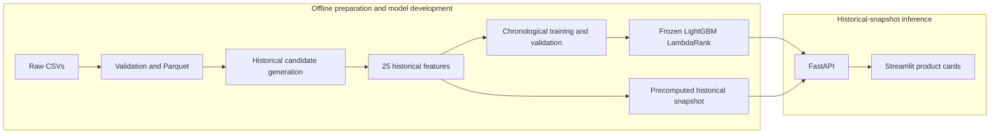

# Smart Order ML
**End-to-End Retail Product Recommendation System**

An independent portfolio project using **Dunnhumby Complete Journey** to recommend
relevant products for a household's next shopping period. The goal is to make
repeat shopping more convenient by ranking **five products for a seven-day
purchase horizon**.

The solution combines historical candidate generation, **25 point-in-time
features**, **LightGBM LambdaRank**, a **FastAPI** inference service and a
**Streamlit** frontend. It is separate from any employer's internal system and
has not been commercially deployed or shown to produce business uplift.

| Metric | Verified result |
|---|---:|
| LambdaRank NDCG@5 | **0.180820** |
| Global popularity NDCG@5 | 0.081921 |
| NDCG@5 ratio vs. popularity | **Approximately 2.21×** |
| LambdaRank Recall@5, micro | 6.9470% |
| Candidate recall, micro | 31.7649% |
| Automated tests | **86 passed** |

These are **offline held-out test results** and the latest verified local test
count (2026-10-24), not commercial uplift. A 2.21× NDCG ratio corresponds to about
**120.73% higher NDCG**, not a 221% improvement.

> **Demo availability:** datasets, models and snapshots are ignored by Git, and
> **no downloadable frozen model/demo bundle is currently provided**. A fresh
> clone cannot run inference without separately supplied artifacts. Docker
> execution and clean-machine reproducibility remain unverified.

## Architecture



The model and serving snapshot are prepared offline. FastAPI loads them at startup
and scores a household's existing candidates on request. It **does not retrain,
rebuild candidates or compute future labels** during inference.

## Methodology

**Candidates.** Up to approximately **200 products per household-week** are drawn
from three historical sources: up to 80 recent repeat products, up to 60 popular
products from the household's top three categories, and global popularity to fill
the deduplicated pool. Category history uses 84 days; recent global popularity uses
28 days, with all-history popularity as a shortage fallback. The 200-candidate cap
was an **initial pragmatic scope decision, not an optimized candidate count**.

**Features.** The 25 ordered float32 features use only information available at
each cutoff:

| Feature group | Count | Examples |
|---|---:|---|
| Household activity | 6 | Purchase-row frequency, spend, product diversity, recency |
| Product activity | 6 | Purchasing-household counts, popularity, historical mean price |
| Household–product history | 7 | Repeat frequency, quantity, spend, recency, mean price |
| Affinity and relative price | 3 | Category affinity, brand affinity, household-relative price |
| Candidate-source flags | 3 | Repeat, category and popularity source membership |

The exact ordering is in [the feature schema](configs/feature_schema_v1.json).
Identifiers and labels are excluded from model inputs.

**Labels and time boundaries.** For cutoff `c`, history uses positive-quantity
purchases with `DAY <= c`. A distinct household–product purchase in
`c < DAY <= c+7` is relevant; other candidate rows receive label zero. Future
positives are never injected into candidate sets.

| Split | Weekly prediction cutoffs | Target-day coverage |
|---|---|---|
| Train | 365–533 | 366–540 |
| Validation | 540–617 | 541–624 |
| Held-out test, already evaluated | 624–701 | 625–708 |

Historical-only snapshot checks and future-perturbation tests guard against
leakage. At later rolling cutoffs, earlier observed purchases can enter history.
Queries are **household–cutoff ranking groups**, with feature/label alignment,
group sizes and offsets verified before use.

**Ranking.** LambdaRank learns within-group product ordering from binary relevance.
Validation selected the boosting iteration; the final frozen model has **152
trees**. Ranking seeds, parameters and provenance are recorded in the
[model configuration](configs/lambdarank_v1.json) and
[training contract](docs/phase3_contract.md). The test period is already consumed:
it must not be reused for tuning or new untouched-test claims.

## Model evaluation and limitations

The final evaluation used **29,993 household-week groups** and **5,998,600
candidate rows**, with identical candidates for both models.

| Held-out metric | Global popularity | Frozen LambdaRank |
|---|---:|---:|
| End-to-end NDCG@5, all groups | 0.081921 | **0.180820** |
| Precision@5, all groups | 6.6942% | **15.6943%** |
| Recall@5, micro | 2.9632% | **6.9470%** |
| Candidate recall, micro | 31.7649% | 31.7649% |
| Repeat-product Recall@5, micro | 5.2963% | **12.8165%** |

NDCG is a macro average over groups; zero ideal denominators contribute zero.
End-to-end NDCG normalizes against all actual target products, including retrieval
misses. Micro Recall@5 divides total Top 5 hits by total target products.
No-purchase and zero-positive groups stay in evaluation.

**Retrieval and ranking are separate constraints.** Candidate recall measures
which actual purchases reached the candidate pool. The ranker cannot recover
products outside that pool, and five recommendation slots also limit recall.
Candidate-only ranking metrics and exact denominators are documented in the
[final evaluation](reports/phase4_test.md) and
[repeat-purchase diagnostic](reports/phase4_repeat_diagnostic.md).

### Stronger personalized baseline — post-hoc diagnostic

After final testing, an 84-day household–product purchase-row-frequency baseline
was evaluated using the same frozen candidate pools. It ranks only historically
purchased candidates; non-repeat products are ineligible and unfilled slots count
as misses. This was **post-hoc analysis**, not a prespecified model-selection
experiment.

| Repeat-purchase result, all test groups | Household frequency | Frozen LambdaRank |
|---|---:|---:|
| Repeat hits in Top 5 | 21,944 | **23,524** |
| Repeat-product Recall@5, micro | 11.955716% | **12.816545%** |

The ranker's 1,580 additional repeat hits represent a **7.20%** increase over this
stronger baseline. This remains descriptive offline evidence, not measured
shopping convenience or causal business impact.

**Discovery limitation.** The model strongly favors repeat purchases and is weaker
at new-product discovery. A validation experiment reserved the fifth slot for a
new-to-household product. It increased discovery but reduced overall NDCG@5 from
**0.183540 to 0.170303**, so the rule was **not adopted**. The original Strategy A
Top 5 remains unchanged. See [the experiment](reports/phase3_2_discovery.md) and
[held-out verification](reports/phase4_checkpoint.md).

## Application Demo

Select a household in **Streamlit** and click **Get Recommendations** to receive
five ordered product cards from the existing **FastAPI** backend. The demo uses
the precomputed **cutoff-day-701** historical snapshot to predict purchases on
days **702–708**; it is not live personalized shopping data.

Product descriptions and categories come from the original catalog, not invented
names or prices. The dataset provides taxonomy descriptions rather than
commercial product names. Missing metadata is labeled unavailable. Model version,
cutoff, product IDs and raw scores appear in expandable technical details.
**Ranking scores are not purchase probabilities.**

Startup commands and required artifacts are listed below. The
[frontend checkpoint](reports/phase5_streamlit_checkpoint.md) records the local
HTTP and rendered-widget smoke checks.

## Installation and reproducibility

Choose between **reproducing development work from a fresh clone** and **running
the frozen demo with existing local artifacts**. They are different workflows:
training a new development model does not create the exact frozen serving bundle.

### Environment — Windows PowerShell

Run commands from the repository root. The supported runtime is **Python 3.12**;
the verified environment is **3.12.15, Windows x86-64**. With Conda installed,
create a new prefix only if one does not already exist:

```powershell
conda create --prefix .venv-phase2 --file environment/conda-win-64.lock.txt --yes
.\.venv-phase2\python.exe -m pip install -r requirements-phase2.lock.txt
.\.venv-phase2\python.exe -m pip install -r requirements-ui.txt
.\.venv-phase2\python.exe -m pip check
```

These commands use Conda's root-level `python.exe`; a standard Windows `venv`
instead uses `Scripts\python.exe`. The legacy `.venv` and `requirements.txt`
describe Phase 1 ingestion, not the current ML/API/UI environment.

The Conda lock is Windows-specific. The Phase 2 lock pins the original runtime
packages; UI requirements constrain shared versions. New UI/Linux transitive
packages and the Docker base-image tag are not fully locked. A clean-machine
installation has not been verified.

### Fresh clone: acquire and preprocess the dataset

Obtain the eight CSVs from the [source dataset](https://www.kaggle.com/datasets/frtgnn/dunnhumby-the-complete-journey)
or the [documented mirror release](https://github.com/bltap-plmarket/dunnhumby-complete-journey/releases/tag/v1.0-data).
The original mirror archive is 135,859,064 bytes. The following checks its
SHA-256 before extraction and refuses to replace an existing archive:

```powershell
New-Item -ItemType Directory -Force data\raw | Out-Null
$datasetArchive = 'data\raw\dunnhumby-complete-journey-data.zip'
if (Test-Path -LiteralPath $datasetArchive) { throw 'Archive exists; verify and reuse it instead.' }
Invoke-WebRequest -UseBasicParsing -Uri 'https://github.com/bltap-plmarket/dunnhumby-complete-journey/releases/download/v1.0-data/dunnhumby-complete-journey-data.zip' -OutFile $datasetArchive
$expectedDatasetSha = '324288a8811c4ed86e85415fdee36f3692582e2cc9dd87866c0e333df237f782'
if ((Get-FileHash -LiteralPath $datasetArchive -Algorithm SHA256).Hash -ne $expectedDatasetSha) { throw 'Dataset archive checksum mismatch.' }
Expand-Archive -LiteralPath $datasetArchive -DestinationPath data\raw
```

The local original archive matched that digest; full download availability has
not been retested during README preparation. Place these files directly in
`data/raw/`: `campaign_desc.csv`, `campaign_table.csv`, `causal_data.csv`,
`coupon.csv`, `coupon_redempt.csv`, `hh_demographic.csv`, `product.csv` and
`transaction_data.csv`.

### Development reproduction — separate copy only

**Use a separate reproduction copy/checkout. Do not run these commands over the
frozen workspace.** They are not needed for the interview demo.

```powershell
.\.venv-phase2\python.exe scripts/ingest_data.py
.\.venv-phase2\python.exe scripts/build_training_data.py --config configs/data_v1.json --output artifacts/data/retail-ranking-reproduction-v1
.\.venv-phase2\python.exe scripts/train_ranker.py --data artifacts/data/retail-ranking-reproduction-v1 --output artifacts/models/reproduction-v1 --config configs/lambdarank_v1.json
```

Ingestion writes Parquet and **replaces `reports/data_exploration.md`** in that
copy. The builder creates train/validation rows, targets, groups and manifests;
existing output directories are refused. `--limit-cutoffs 1` is smoke mode only
and is rejected by the full training loader.

The final command **trains a new model** and writes a new artifact directory.
It also **replaces `reports/phase3_validation.json` and `.md` regardless of
`--output`**; changing only the model directory does not protect those reports.
Exact published model bytes or metrics are not promised for a new run, and
`reproduction-v1` is not automatically served by the API.

The historical `scripts/evaluate_heldout.py` is pinned to the approved model hash
and checkpoint; it writes test artifacts and Phase 4 reports. It is not a generic
new-model evaluator or serving-bundle exporter. `scripts/verify_heldout.py` also
writes its verification report. Neither belongs in frozen-demo startup.
See the [data contract](docs/phase2_contract.md) for further details.

### Frozen demo: separately provisioned local artifacts

**There is no public download URL or automatic provisioning for these files.**
They are ignored by Git and must already exist at these repository-relative paths:

| File | Purpose |
|---|---|
| `artifacts/models/lambdarank-v1/model.txt` | Frozen trained model |
| `artifacts/models/lambdarank-v1/manifest.json` | Model provenance/checksums |
| `artifacts/models/lambdarank-v1/feature_schema.json` | Ordered feature schema |
| `artifacts/data/retail-ranking-test-v1/manifest.json` | Snapshot provenance/checksum |
| `artifacts/data/retail-ranking-test-v1/test/cutoff_701/rows.parquet` | Historical candidate features |
| `data/processed/product.parquet` | Optional real product descriptions/categories |

The five mandatory files total approximately 8.6 MB. Missing catalog metadata
leaves IDs/scores intact with unavailable descriptions. Startup checks artifact
integrity, feature order and the saved temporal audit. The approved model SHA-256
is `af9492f58af0b891b6f766213a5eb823bbb7fbf46aeb1719aba6c406515219ec`.
Inspect it without training:

```powershell
Get-FileHash -LiteralPath artifacts\models\lambdarank-v1\model.txt -Algorithm SHA256
```

## Running FastAPI and Streamlit

With the environment and frozen local artifacts present, start **terminal 1**:

```powershell
.\.venv-phase2\python.exe -m uvicorn retail_recs.api:create_app --factory --app-dir src --host 127.0.0.1 --port 8000
```

The factory loads the frozen model and snapshot once. Unknown households return
404; nonpositive/noninteger IDs return 422. After startup, check the service:

```powershell
Invoke-RestMethod http://127.0.0.1:8000/health
Invoke-RestMethod http://127.0.0.1:8000/recommendations/1 | ConvertTo-Json -Depth 5
(Invoke-WebRequest -UseBasicParsing http://127.0.0.1:8000/docs).StatusCode
.\.venv-phase2\python.exe -B scripts/verify_api_demo.py --url http://127.0.0.1:8000
```

The verifier requires the local ML/API environment including httpx; it checks
matching IDs/order and scores within absolute tolerance 1e-12.

Start **terminal 2**:

```powershell
.\.venv-phase2\python.exe -m streamlit run streamlit_app.py --server.address 127.0.0.1 --server.port 8501
```

Open **http://127.0.0.1:8501**, choose household **1**, and click **Get
Recommendations**. Stop either process with Ctrl+C in its terminal.

No environment variable is required by default. If FastAPI uses another port,
change its `--port` and set the matching URL before starting Streamlit:

```powershell
$env:RETAIL_API_URL = 'http://127.0.0.1:8001'
```

## Tests and verification

The latest complete local run passed **86 tests on 2026-10-24**, including exact
equality of **all 500,000 cutoff-701 model scores** with saved Phase 4 predictions.

```powershell
$pytestTemp = Join-Path 'tmp' ('pytest-' + [guid]::NewGuid().ToString('N'))
.\.venv-phase2\python.exe -B -m pytest tests/ -v -p no:cacheprovider --basetemp="$pytestTemp"
```

The dedicated temporary directory isolates test outputs. The synthetic
fit/save/reload unit test fits only a small temporary fixture, never the frozen
retail model. Other checks cover temporal invariance, ranking groups, metric
definitions, metadata, UI error paths and API parity.

Full API checks require the local artifacts. The 500,000-score test additionally
needs `artifacts/evaluations/heldout-v1/test_predictions.parquet`; this saved
reference is **not required for inference**. API tests skip without model/data
prerequisites, and frontend tests skip without Streamlit. Check pass/skip counts:
a green source-only run does not establish complete demo parity.

## Repository structure

```text
src/retail_recs/     Data contracts, candidates, features, ranking, API, HTTP client
scripts/            Ingestion, development training and verification entry points
tests/              Data, temporal, ranking, API and frontend tests
configs/            Data, feature-schema and model configuration
environment/        Windows Conda runtime lock
data/raw/           Archive and CSVs (ignored)
data/processed/     Generated Parquet tables (ignored)
artifacts/          Versioned data/model/evaluation outputs (ignored)
reports/            Measured results and technical handovers
streamlit_app.py    Interview frontend
.streamlit/         Tracked theme config; secrets.toml is ignored
Dockerfile          Minimal backend container configuration
```

Further records: [ingestion](reports/data_exploration.md),
[data integration](reports/phase2_data_checkpoint.md),
[model comparison](reports/phase3_checkpoint.md), and
[API integration](reports/phase5_api_checkpoint.md).

## Known limitations and future improvements

- **Artifact availability:** no public frozen bundle; fresh-clone inference is
  blocked until artifacts are supplied. Training reproduction does not provision
  the historical serving snapshot.
- **Validation scope:** Windows local behavior is verified; clean-machine setup
  and Docker execution are not. UI/Linux transitive dependencies and the base
  image are not fully locked.
- **Model scope:** discovery is weaker than repeat prediction; retrieval coverage
  and Top 5 capacity constrain recall. Static catalog attributes are assumed;
  inventory and current product prices are not modeled.
- **Deployment scope:** this is a localhost portfolio demo without a production
  security/scaling assessment, not an internet-facing retail deployment.
- **Possible next work:** review artifact distribution/licensing, verify a clean
  installation and Linux container, and consider further explainability. These
  are future tasks, not implemented or validated capabilities.

### Docker — configuration only, execution unverified

The image requires the same five local serving artifacts before building; it
does not download them. It packages FastAPI, not Streamlit or the product catalog,
so product metadata is null. The earlier reduced-bundle check used Windows
Python, not Docker. See the [Docker checkpoint](reports/phase5_docker_checkpoint.md).

With Docker Desktop's Linux engine available, the following commands remain
**unverified execution steps**. Ensure host port 8000 is free first:

```powershell
docker version
docker build --platform linux/amd64 -t retail-recs-demo:phase5 .
docker run --detach --rm --name retail-recs-demo -p 127.0.0.1:8000:8000 retail-recs-demo:phase5
docker logs retail-recs-demo
# After startup completes:
.\.venv-phase2\python.exe -B scripts/verify_api_demo.py --url http://127.0.0.1:8000
docker stop retail-recs-demo
```

`--rm` removes the stopped container. Linux dependency installation, runtime
permissions and cross-platform score parity have not been established.

## Dataset attribution and licensing

Dataset: [Dunnhumby Complete Journey](https://www.kaggle.com/datasets/frtgnn/dunnhumby-the-complete-journey).
The [documented mirror](https://github.com/bltap-plmarket/dunnhumby-complete-journey/releases/tag/v1.0-data)
identifies its contents license as
[DbCL-1.0](https://opendatacommons.org/licenses/dbcl/1.0/). Review the applicable
terms and publication of the existing household-level diagnostic examples before
distributing data or derived snapshots. Dataset terms are separate from source-code
licensing and third-party dependency licenses.

**No source-code license has been approved or added.** MIT remains a recommendation
for the author's own code, not an adopted license.
